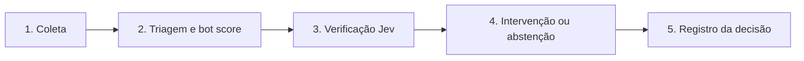

# Como funciona o ContrarIA: o pipeline do agente

Este guia explica a arquitetura operacional do ContrarIA. O backend padrão de
verificação é o Jev local; o caminho anterior baseado integralmente em LLM
continua disponível para experimentos, mas não é o usado pelo worker quando
`VERIFICATION_BACKEND=jev`.

## Visão geral

O ContrarIA acompanha publicações políticas em português no Bluesky, seleciona candidatos, busca evidências e decide se há fundamento para uma intervenção. Quando faltam evidências, ele se abstém. O processo pode ser entendido em cinco etapas:

## 1. Coleta: encontrar publicações

O Jetstream fornece eventos de novas publicações. Em paralelo, buscas periódicas com `searchPosts`, ordenadas por `top`, recuperam posts das últimas 24 horas que podem ter circulado antes de o agente iniciar. A coleta filtra idioma português e palavras-chave políticas, evita duplicatas pela URI e guarda um cursor para retomar o fluxo após reiniciar.

É como acompanhar as notícias que chegam e também consultar as que já ganharam atenção.

**Referências:** [RF01](../requisitos.md), [ADR 0009](../adr/0009-coleta-hibrida-jetstream-searchposts.md).

## 2. Triagem: escolher o que investigar

A triagem acontece em duas camadas, e só a segunda é cara.

**Priorização barata (`EngagementRefresher`, a cada 5 minutos).** Para os posts das últimas 48 horas, o worker
consulta o engajamento atual, grava um *snapshot* e calcula a **velocidade de propagação** (interações novas por
hora entre snapshots). A relevância combina, em escala logarítmica, engajamento, velocidade e seguidores do autor. A
matriz GQ04 transforma isso em `triage_status` (`monitor`, `queued` ou `discarded`) e `priority`. Posts já
`processed` ou `ignored` não voltam para a fila.

**Análise cara (pool do worker, 3 simultâneas por padrão).** Os candidatos `monitor` e `queued` são lidos por
`priority` decrescente, respeitando a **janela de maturação (aging delay de 3 h a 48 h)** ([ADR 0022](../adr/0022-janela-de-maturacao-e-critic-semantico.md)):
posts com menos de 3 h aguardam na fila para que haja tempo hábil de publicação e indexação de matérias e checagens;
posts com mais de 48 h expiram automaticamente. A fila tem teto de 100 posts: cheia, a coleta descarta os novos, e 30 vagas ficam reservadas ao
`searchPosts` ([ADR 0018](../adr/0018-concorrencia-e-contrapressao-do-worker.md)). Para cada um, o `PipelineService` calcula o **bot score** da conta: pesos em
`domain/bot_weights.yaml` sobre características demográficas, de rede, temporais e de conteúdo, passados por uma
sigmoide e guardados em cache por 24 horas. Uma nota alta é um indício, não prova de automação.

!!! note "Pré-filtro clássico fora do fluxo"
    O classificador TF-IDF (`FakeNewsTFIDFClassifier`) foi treinado e avaliado em `research/`, mas **não está ligado
    ao worker**, por decisão do [ADR 0015](../adr/0015-pre-filtro-tfidf-nao-integrado.md): em posts reais do Bluesky
    ele chegou a ROC-AUC 0,76 (F1 0,72, amostra pequena), contra 0,99 em notícias, e a verificação local eliminou o
    argumento de custo. Hoje a fila usa relevância, velocidade de propagação e bot score. Esses sinais medem alcance,
    não a chance de o post ser falso.

É como organizar uma fila de investigação: prioridade não é condenação.

**Referências:** [RF02, RF04, RF08, RF09, RF10 e RF12](../requisitos.md), [ADR 0006](../adr/0006-bot-score-heuristico.md), [ADR 0008](../adr/0008-pre-filtro-classico.md), [ADR 0022](../adr/0022-janela-de-maturacao-e-critic-semantico.md).

## 3. Verificação Jev: confrontar a alegação com evidências

1. **Separar frases candidatas:** o worker divide o post e, quando disponível, o contexto do fio. Uma heurística determinística (sem LLM nem Jev) mantém só as frases com ancoramento factual (número, título político, sigla institucional, predicado fático ou nome próprio) e descarta perguntas, expressões idiomáticas e hashtags de campanha; sem frases candidatas, a análise encerra sem ação. Essa heurística ainda não tem validação quantitativa.
2. **Ler a fonte que o próprio post cita:** o link do card, dos facets ou do texto é lido primeiro. O NLI compara a alegação com o título e com janelas de duas frases da matéria e fica com o maior entailment (abordagem SummaC/AlignScore). Se passa do limiar e a fonte é jornalística, de checagem ou oficial, o post é dado como `source_consistent` (consistente com a matéria que cita; a veracidade da matéria não foi avaliada) e não há intervenção. Se a fonte é desconhecida ou não sustenta a alegação, ela entra como mais uma evidência ([ADR 0019](../adr/0019-fonte-citada-pelo-post-e-entidade.md)).
3. **Buscar evidências** (interjeições como "Ah, pelo amor de Deus.", frases em primeira pessoa sem número com unidade e fragmentos curtos só com um nome próprio não viram alegação nem geram busca): cada alegação factual consulta as fontes habilitadas — agências de checagem, Wikipédia, busca web e acervo RSS. A busca web utiliza primariamente a instância self-hosted do SearXNG (com fallback para o DuckDuckGo; o Tavily usado no MVP foi removido, ver [ADR 0016](../adr/0016-remocao-do-tavily.md)) e extração estruturada de conteúdo com Trafilatura, evitando dependência de créditos e ruídos de raspagem HTML. As fontes externas contam com disjuntor de proteção e cooldown ([ADR 0021](../adr/0021-resiliencia-das-fontes-de-evidencia.md)). Para alegações longas ou compostas, além da frase específica sem URLs, o sistema gera consultas menores com os principais termos e subalegações.
4. **Filtrar relevância:** o Jev compara alegação e trecho de fonte. O filtro determinístico ainda bloqueia entidades conflitantes e coincidências genéricas, mas fontes confiáveis com sobreposição temática (pelo menos 3 palavras informativas **e** uma entidade ou sigla da alegação presente na fonte) seguem para o classificador local, que decide se confirmam ou desmentem o caso. Fontes encaminhadas só por tema exigem margem de relevância maior (0,4, contra 0,15 das ancoradas), para que páginas genéricas da Wikipédia não sustentem um veredito. Isso evita transformar a ausência de uma frase literal em `insufficient_evidence` automático.
5. **Classificar o veredito:** com as fontes relevantes, o Jev escolhe entre "confirmam a alegação", "desmentem a alegação", "confirmam o fato, mas desmentem a conclusão ou o exagero" e "as evidências são insuficientes ou não tratam da alegação". Isso produz, respectivamente, `true`, `false`, `misleading` ou `insufficient_evidence`.
6. **Aplicar o controle de risco:** o Conformal Risk Control (CRC) usa um limiar aprendido com exemplos rotulados para **esse modelo Jev**, com tolerância de 5% para a perda de falsos positivos na calibração. Não é uma regra fixa de confiança nem garantia de acerto em todos os casos. Sem calibração ou abaixo do limiar, a decisão é `insufficient_evidence` e não há intervenção.

É como uma análise pericial que só conclui quando a fonte trata do fato
específico e a confiança passou por uma calibração empírica.

**Referências:** [ADR 0013 — backend Jev](../adr/0013-backend-local-jev.md),
[ADR 0014 — busca SearXNG e Trafilatura](../adr/0014-busca-web-searxng-trafilatura.md),
[ADR 0021 — resiliência das fontes](../adr/0021-resiliencia-das-fontes-de-evidencia.md) e
[guia de calibração](../calibracao-jev.md). O fluxo CoVe/Self-RAG/debate do
[ADR 0007](../adr/0007-verificacao-cove-selfrag-mad-crc.md) permanece como
backend alternativo (`VERIFICATION_BACKEND=llm`).

## 4. Ação: intervir somente quando houver fundamento

Depois da verificação, a **matriz GQ01** (no `PipelineService`) escolhe a ação, nesta ordem:

1. **`IGNORE`:** bot score acima de 0,9 e conta abaixo do piso de seguidores (`PIPELINE_MIN_FOLLOWERS_FOR_INTERVENTION`). O piso é **0** desde 14/10/2026 ([ADR 0024](../adr/0024-remove-piso-de-seguidores-e-faixa-de-silencio.md)), então esta regra não dispara; para reativar, defina por exemplo `500`.
2. **`MONITOR`:** veredito `insufficient_evidence`.
3. **`INTERVENE_QUEUED`:** veredito `false` ou `misleading` e autor com seguidores no mínimo igual ao piso (hoje 0, ou seja, qualquer autor).
4. **`MONITOR`:** qualquer outro caso, inclusive intervenção desabilitada por *feature flag*.

O candidato **não é publicado na hora**. Ele entra na `InterventionQueue` e, a cada rodada de 15 minutos, só o de
**maior confiança** é publicado; os demais são fechados como `MONITOR`. A faixa de silêncio de 0h às 7h (Brasília) existe, mas está **desligada** desde 14/10/2026 (`INTERVENTION_QUIET_HOURS_ENABLED=false`); com `true` não há rodada de publicação nesse horário. A fila vive na memória: se o worker reinicia, os pendentes
são fechados como `MONITOR`.

Em desenvolvimento e na primeira validação de produção, mantenha `INTERVENTION_DRY_RUN=true`: a decisão e a ação
calculada são registradas, mas o quote não é enviado ao Bluesky. Só `false` habilita a publicação depois das demais
travas.

O candidato escolhido passa pelas travas do `InterventionService`: confiança mínima de 0,8, anti-loop (nunca citar o
próprio bot nem contas com rótulo `bot`), um quote por post e um por autor a cada 24 horas, teto diário de quotes,
orçamento de pontos de escrita e `postgate` que desabilite citações.

### Context Gate e Pacote de Contexto (`PostContextBundle`)

Antes de gerar a resposta, o sistema monta um feixe de contexto estruturado ([ADR 0028](../adr/0028-context-gate-e-critic-v2.md)):

* **Histórico do Fio (`thread_context`):** Busca os ancestrais imediatos e continuações do mesmo autor via `BlueskyClient.get_thread_context()`.
* **Citação Embutida (`quote post embed`):** Extrai do registro AT Protocol (`thread.post.embed`, cobrindo `app.bsky.embed.record` e `recordWithMedia`) o autor e o texto do post citado (`quote_author`, `quote_text`, `quote_uri`), evitando interpretar ironias sobre o post citado como se fossem a opinião do autor.
* **Matérias Compartilhadas (`shared_link_text`):** Quando o post inclui links externos, o conteúdo textual da matéria é hidratado via `fetch_article_text` para que o bot entenda a que notícia o usuário está se referindo.

Esse pacote (`PostContextBundle`) é injetado no redator socrático (`quote_post_v2.txt`), na verificação de alucinação de entidades e no Critic Semântico V2.

### Tipologia de Intervenção e Sensibilidade a Atos de Fala

Nem toda publicação com veredito adverso justifica um quote post público. O sistema categoriza as interações em quatro tipos:

| Tipo | Condição | Ação | Justificativa |
|---|---|---|---|
| **`DIRECT_FACT_CHECK`** | Post afirma expressamente fato desmentido por checagem da agência. | **INTERVENE** | Intervenção socrática clássica com link da checagem. |
| **`CONTEXTUAL_FACT_CHECK`** | Post noticia evento real onde circularam mídias manipuladas ou distorções no quote embed. | **INTERVENE** | Pergunta socrática contextual abordando a relação entre post e citação, sem acusação direta. |
| **`UNSUPPORTED_ASSOCIATION`** | Post trata de evento real, mas a checagem foca em detalhes numéricos ou declarações ausentes no post. | **ABSTAIN** | Veto obrigatório: evita imputar ao autor desinformações que ele não afirmou. |
| **`SPEECH_ACT_HUMOR`** | Meme, piada, sátira, desabafo genérico ou risadas expressas ("KKKK"). | **ABSTAIN** | Veto obrigatório: robô não responde a humor ou desabafos coloquiais. |

### Critic Semântico V2 (Fail-Closed)

Antes da publicação, o texto redigido é auditado pelo Critic Semântico V2 (`ENABLE_SEMANTIC_CRITIC=true`, prompt `semantic_critic_v2.txt`, [ADR 0028](../adr/0028-context-gate-e-critic-v2.md)):

* **Aprovação Estritamente Explícita:** A intervenção só é publicada se o LLM responder com a linha `DECISAO: APROVADA` (e sem a presença de `REPROVADA`).
* **Modo Fail-Closed:** Se a chamada ao LLM falhar, sofrer timeout, retornar vazia ou devolver uma resposta fora do formato estruturado, a intervenção é **automaticamente cancelada** (`return False, reason`), registrando abstenção em `decisions`.
* **Veto a Desconexões Semânticas:** O Critic veta peremptoriamente textos que imputem ao autor personagens, declarações, leis ou acusações ausentes no post e no contexto do fio.
* **Veto a Humor e Sátira:** Detectando ato de fala humorístico ou meme no contexto, o Critic emite `DECISAO: REPROVADA`.

### Parser Estrito de Fontes

O método `_parse_agent_output()` analisa a saída gerada pelo redator. Ao contrário de versões anteriores que aplicavam um fallback silencioso para a primeira fonte da lista (`sources[0].url`), o parser atual é estrito: se o modelo não citar expressamente uma URL válida que coincida com as fontes recuperadas e analisadas, a intervenção é cancelada (`return "", []`), impedindo citações de links alucinados ou inadequados ([ADR 0028](../adr/0028-context-gate-e-critic-v2.md)).

Quote posts notificam o autor. A decisão aceita o risco relacionado à diretriz de opt-in descrito no ADR 0002; a
citação não elimina esse risco. Com `INTERVENTION_DRY_RUN=true` (padrão) nada é publicado.

A rotulagem pelo **Ozone** é complementar, por uma conta dedicada de labeler, e só age com `PIPELINE_LABELER_ENABLED=true`. Há dois rótulos:
`possivel-desinformacao` no **post** citado, emitido após o quote publicado e fora do *dry-run* através da **outbox resiliente**
(`LabelOutbox`, com repetições automáticas em caso de indisponibilidade do túnel do Ozone; [ADR 0023](../adr/0023-outbox-de-rotulos-do-ozone.md));
e `provavel-bot` na **conta**, emitido para toda conta analisada cujo bot score passa de 0,9 (com ao menos 20 posts) e negado quando cai abaixo de 0,8,
independentemente de quote ([ADR 0017](../adr/0017-rotulagem-de-contas-ao-vivo.md)). Uma revisão
com `reverter` nega o rótulo (`action="negate"`) sem apagar o histórico.

Conteúdo verdadeiro ou não factual não recebe intervenção corretiva. Um resultado inconclusivo causa abstenção, sem ação penalizadora.

**Referências:** [RF05, RF06 e RF07](../requisitos.md), [ADR 0002](../adr/0002-quote-post.md), [ADR 0003](../adr/0003-labeler-ozone.md), [ADR 0022](../adr/0022-janela-de-maturacao-e-critic-semantico.md), [ADR 0023](../adr/0023-outbox-de-rotulos-do-ozone.md), [ADR 0028](../adr/0028-context-gate-e-critic-v2.md).

## 5. Auditoria: registrar o motivo da decisão

A decisão, inclusive monitoramento ou abstenção, deve ser registrada com os dados necessários para explicar seu resultado: publicação, data, bot score, evidências, reflexões, debate, limiar usado e ação tomada. Isso permite revisar os motivos e corrigir decisões posteriores sem perder o histórico.

É o registro que permite ao avaliador conferir como a conclusão foi construída.

**Referências:** [RF13 e RNF06](../requisitos.md), [visão geral da arquitetura](index.md) e [modelo de dados](dados-e-infra.md).

### Guardas do veredito adverso (14/10/2026)

- **Fonte independente ([ADR 0026](../adr/0026-reverte-exigencia-de-casamento.md)):** `false` ou `misleading` só valem se ao
  menos uma evidência relevante vier de checagem, imprensa ou fonte oficial (autoridade ≥ 2). Só Wikipédia, ou o link do
  próprio post, vira `insufficient_evidence` (`weak_sources_only` no log). O acervo RSS também não conta como fonte forte aqui: ele só
  acusa pelo casamento exato com a alegação checada (abaixo). Em teste com posts de produção, qualquer artigo do acervo
  sustentava acusações a posts sem relação ("Excelente, presidente Lula!").
- **Casamento com checagem (caminho adicional):** se o post repete a alegação que uma agência marcou como falsa ou
  enganosa (termos específicos em comum, cobertura de metade da alegação e entailment NLI ≥ 0,7), o veredito sai direto da
  nota da agência (`claim_match` no log). Posts que já desmentem ("É falso que…") não casam.
- **Linhas quebradas:** uma linha sem pontuação final seguida de linha que começa com negação, conectivo ou minúscula é
  unida à anterior, para que "AS URNAS ELETRÔNICAS / NÃO TEM FRAUDE" não perca o "NÃO". Sequências como `???` viram uma
  pontuação só e não transformam a frase em pergunta.
- **Margem factual vs opinião:** a frase só segue se `factual` superar `opiniao` em pelo menos 0,1.

## Coletor de alegações checadas

Além do fluxo acima, o worker parte das checagens de agências e busca no Bluesky quem as repete
([ADR 0027](../adr/0027-coletor-de-alegacoes-checadas.md), corrigido e fortalecido pelo [ADR 0028](../adr/0028-context-gate-e-critic-v2.md)).
A cada hora ele pega as alegações falsas ou enganosas dos últimos 30 dias (Google Fact Check e acervo RSS), busca os dois
termos mais raros de cada uma e filtra desmentidos, contradições (NLI do Jev) e posts que cobrem menos da metade da
alegação (ponderada por IDF).

### Correções Estruturais e Filtro de Pertinência Proposicional ([ADR 0028](../adr/0028-context-gate-e-critic-v2.md))

No desenho inicial do coletor, duas fragilidades foram identificadas e resolvidas:

1. **Atribuição Correta da Alegação Checada:** O veredito gerado pelo coletor agora atribui obrigatoriamente a alegação checada pela agência (`verdict.claim = candidate.checked`), em vez do texto do post (`post.text[:300]`). Anteriormente, o filtro comparava o post contra si próprio, permitindo que falsidades da checagem fossem associadas indevidamente ao usuário.
2. **Sobreposição Lexical Multi-token (`_is_claim_relevant_to_post`):** A verificação de pertinência antes da intervenção não aceita uma única palavra compartilhada isolada (ex.: tema comum como "Tigrinho" ou nome de político). Para alegações com 3 ou mais palavras informativas, o sistema exige ao menos 2 termos nucleares compartilhados, prevenindo que afirmações com polaridades opostas (ex.: "governo proibiu" vs "governo criou") sejam tratadas como a mesma proposição.

Um candidato por rodada entra no pipeline com a checagem como fonte e o veredito da agência; a revisão das fontes, o Context Gate e o Critic V2 decidem se a publicação é autorizada. O log da decisão traz `claim_harvest` (URL, nota, alegação checada e cobertura).

